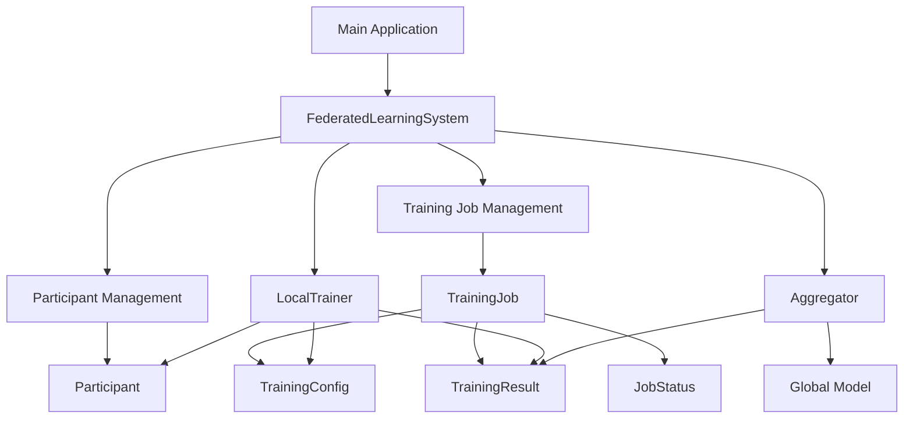
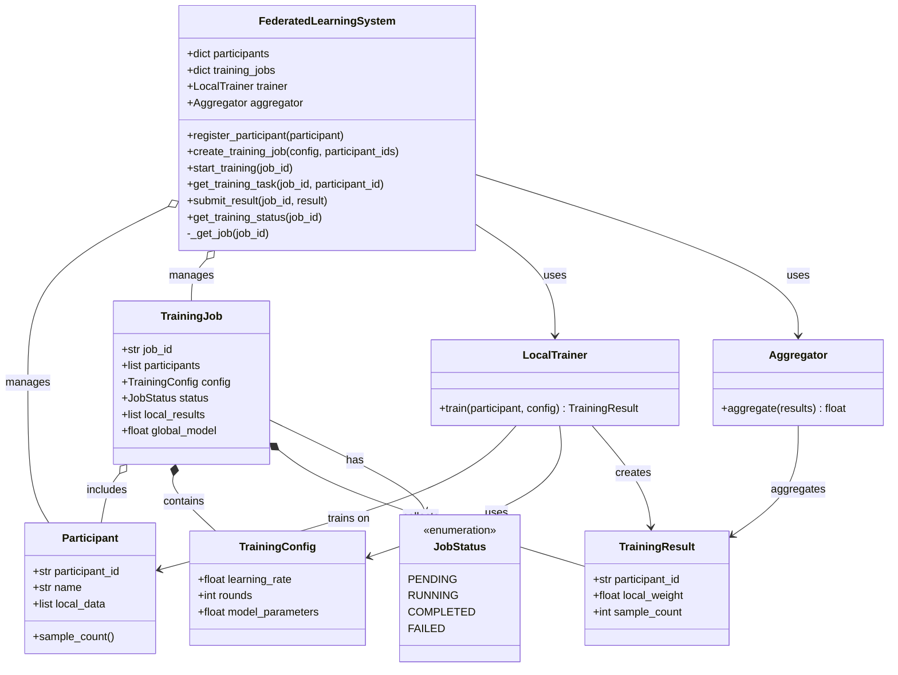
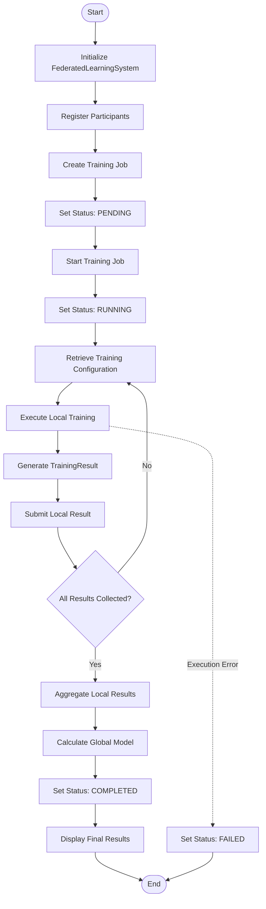

# MiniFed – Phase 1: Monolithic Architecture

## 1. Introduction

The first phase of the MiniFed project focuses on designing and implementing a simplified Federated Learning framework using a monolithic architecture.

The main objective is to simulate the federated learning process within a single application. The system manages participants, creates training jobs, executes local training, collects local results, and aggregates these results to produce a global model.

The implementation is developed in Python and organized into separate modules to ensure clear responsibilities and facilitate its future transformation into a distributed architecture using gRPC.

## 2. Project Objectives

The monolithic implementation aims to:

- Register and manage federated learning participants.
- Create and configure training jobs.
- Assign training tasks to selected participants.
- Simulate local model training.
- Collect local training results.
- Aggregate local results into a global model.
- Track the status of each training job.
- Handle invalid operations and execution errors.

This phase provides the functional foundation for the distributed implementation in Phase 2.

## 3. System Architecture

The monolithic architecture consists of several components organized into three main layers:

- **Models:** Define the system's main data structures.
- **Services:** Implement the business logic.
- **Main Application:** Initializes the system and executes the federated learning workflow.

All components run within a single Python application and communicate through direct method calls.

### 3.1 Architecture Diagram

The following diagram illustrates the main components and their interactions.



### 3.2 Main Components

**FederatedLearningSystem**

The central component responsible for coordinating the entire federated learning process. It manages participants and training jobs and coordinates the local trainer and aggregator.

**Participant**

Represents a participant in the federated learning process. Each participant has an identifier, a name, and local data.

**TrainingConfig**

Contains the configuration required for a training job, including:

- Learning rate.
- Number of training rounds.
- Initial model parameters.

**TrainingJob**

Represents a training execution. It contains the selected participants, training configuration, current status, collected local results, and final global model.

**TrainingResult**

Stores the result produced by a participant after local training. It includes the participant identifier, local weight, and number of samples used.

**LocalTrainer**

Simulates the local training process. It calculates the average value of a participant's local data and returns a TrainingResult.

**Aggregator**

Combines the local results to calculate the global model using weighted averaging based on the number of samples available at each participant.

**JobStatus**

Defines the possible states of a training job:

- PENDING
- RUNNING
- COMPLETED
- FAILED

## 4. Class Diagram

The following class diagram describes the main classes, their attributes, methods, and relationships.



## 5. Project Structure

The source code is organized as follows:

```text
MiniFed/
│
├── monolithic/
│   ├── __init__.py
│   ├── main.py
│   │
│   ├── models/
│   │   ├── __init__.py
│   │   ├── participant.py
│   │   ├── training_config.py
│   │   ├── training_job.py
│   │   ├── training_result.py
│   │   └── job_status.py
│   │
│   └── services/
│       ├── __init__.py
│       ├── local_trainer.py
│       ├── aggregator.py
│       └── federated_learning_system.py
│
├── distributed/
├── docs/
├── tests/
│   └── test_monolithic.py
│
├── .gitignore
└── README.md
```

## 6. Main Components and Responsibilities

### 6.1 FederatedLearningSystem

This class acts as the main orchestrator of the application.

Its responsibilities include:

| Method | Description |
|---|---|
| register_participant() | Registers a new participant. |
| create_training_job() | Creates a training job using registered participants. |
| start_training() | Starts and coordinates the training process. |
| get_training_task() | Retrieves the training configuration for a participant. |
| submit_result() | Receives and stores a participant's local result. |
| get_training_status() | Retrieves the current state and results of a training job. |

The system also checks that participants are registered, prevents duplicate registrations and submissions, and ensures that training jobs follow the expected execution states.

### 6.2 LocalTrainer

The LocalTrainer is responsible for simulating local training.

For this simplified implementation, the local model weight is calculated as the arithmetic mean of the participant's local data:

$$
w_i = \frac{1}{n_i}\sum_{j=1}^{n_i}x_j
$$

Where:

- \(w_i\) represents the local weight of participant \(i\).
- \(n_i\) represents the number of local samples.
- \(x_j\) represents an individual data value.

The trainer returns a TrainingResult containing the calculated weight and sample count.

**Implementation note:** The `learning_rate` and `rounds` parameters are currently stored in TrainingConfig but are not used in this simplified average-based calculation. They are retained to maintain compatibility with the training configuration planned for Phase 2.

This is a simulation of local training, not a complete machine learning optimization algorithm.

### 6.3 Aggregator

The Aggregator combines the local results to calculate the global model.

The implementation uses weighted averaging, giving each participant a contribution proportional to its number of samples.

$$
w_{global} =
\frac{\sum_{i=1}^{N} n_i w_i}
{\sum_{i=1}^{N} n_i}
$$

Where:

- \(N\) is the number of participants.
- \(w_i\) is the local weight of participant \(i\).
- \(n_i\) is the participant's sample count.

This approach ensures that participants with more samples have a proportionally greater contribution to the global result.

## 7. Federated Learning Workflow

The execution follows these steps:

1. The application initializes the FederatedLearningSystem.
2. Participants register with the system.
3. The system creates a training job with a selected group of participants.
4. The job initially receives the PENDING status.
5. The system starts the job and changes its status to RUNNING.
6. Each participant receives the training configuration.
7. The LocalTrainer performs local training using the participant's local data.
8. Each participant produces a TrainingResult.
9. The system collects all local results.
10. The Aggregator calculates the global model.
11. The training job is marked as COMPLETED.
12. The final status and global model are displayed.

If an error occurs during execution, the job status changes to FAILED.

### 7.1 Workflow Diagram



## 8. Example Execution

The application uses three participants:

| Participant | Local Data | Local Result |
|---|---|---:|
| A | [5, 10, 15] | 10.0 |
| B | [10, 20, 30] | 20.0 |
| C | [15, 30, 45] | 30.0 |

Each participant calculates its local average independently.

Since all participants have three samples, the global model is:

$$
w_{global} = \frac{3(10)+3(20)+3(30)}{3+3+3} = 20.0
$$

## 9. Execution

### 9.1 Environment

The project was developed using:

- Python 3.12.2
- Visual Studio Code
- Python virtual environment
- Pytest for automated testing

### 9.2 Activating the Virtual Environment

**Windows (PowerShell):**

```powershell
.venv\Scripts\Activate.ps1
```

**Linux / macOS:**

```bash
source .venv/bin/activate
```

### 9.3 Running the Application

From the project root directory, execute:

```bash
python -m monolithic.main
```

### 9.4 Expected Output

```text
===== PARTICIPANTS REGISTERED =====
Participants: ['A', 'B', 'C']

===== TRAINING JOB CREATED =====
Job ID: JOB-001
Initial status: PENDING

===== STARTING TRAINING =====

===== LOCAL TRAINING RESULTS =====
Participant A: 10.0
Participant B: 20.0
Participant C: 30.0

===== FINAL TRAINING STATUS =====
Job ID: JOB-001
Status: COMPLETED
Global Model: 20.0
```

This execution confirms that the main federated learning workflow operates successfully.

## 10. Testing and Validation

Automated tests were implemented using Pytest to verify the behavior of the main components and system operations.

The test suite covers:

- Successful participant registration.
- Duplicate participant registration.
- Successful training job creation.
- Rejection of unknown participants.
- Successful training execution.
- Duplicate result submission prevention.
- Aggregation with an empty result list.
- Training failure handling.
- Retrieval of an unknown training job.
- Weighted aggregation with different sample counts.

### 10.1 Test Execution

Run the following command from the project root:

```bash
python -m pytest tests/ -v
```

### 10.2 Test Results

The test suite was executed successfully.

```text
======================== test session starts ========================
platform win32 -- Python 3.12.2
collected 10 items

tests/test_monolithic.py::test_register_participant PASSED
tests/test_monolithic.py::test_register_duplicate_participant PASSED
tests/test_monolithic.py::test_create_training_job PASSED
tests/test_monolithic.py::test_create_job_with_unknown_participant PASSED
tests/test_monolithic.py::test_start_training PASSED
tests/test_monolithic.py::test_submit_duplicate_result PASSED
tests/test_monolithic.py::test_aggregate_empty_results PASSED
tests/test_monolithic.py::test_failed_training PASSED
tests/test_monolithic.py::test_get_unknown_training_job PASSED
tests/test_monolithic.py::test_weighted_aggregation PASSED

======================== 10 passed in 0.06s ========================
```

**Result:** All 10 automated tests passed.

These results validate the main operations, input checks, error handling, and aggregation logic implemented in the monolithic version.

## 11. Limitations of the Monolithic Architecture

Although the first implementation successfully simulates the federated learning workflow, it has some limitations:

- All components run within a single application process.
- Participants are represented as local Python objects.
- Communication relies on direct method calls.
- There is no network communication or remote procedure call mechanism.
- Local training is simulated using averages rather than a real machine learning model.
- The LocalTrainer receives the complete Participant object, including its local data. Therefore, the monolithic application has direct access to participant data. Data is not isolated in independent participant processes in this phase.

This last limitation is important: although the implementation follows the federated learning workflow conceptually, it does not yet provide the process-level data isolation expected from a distributed federated learning system.

In Phase 2, each Participant Service will execute training within its own process. The Coordinator Service will send training configurations and receive training results through gRPC. Only the training results will be transmitted back to the coordinator; the participants' local datasets will remain within their respective processes.

## 12. Conclusion

Phase 1 successfully delivers a functional monolithic implementation of the MiniFed framework.

The application supports participant registration, training job management, local training simulation, result collection, weighted aggregation, and job status tracking.

The implementation is structured into independent models and services, making the code easier to maintain and extend.

With all 10 automated tests passing, the monolithic version provides a validated functional foundation for the next phase.

**Phase 2 will transform this centralized application into a distributed service-oriented architecture using gRPC and Protocol Buffers.** The Coordinator Service, Participant Services, and Management Client will run as independent processes and communicate through remote procedure calls.