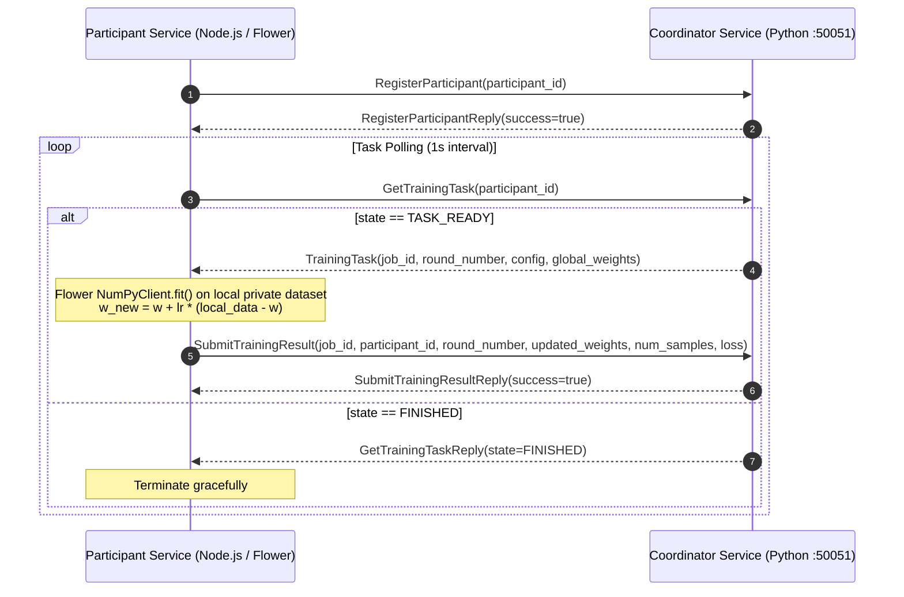

# Participant Service (Node.js & Flower AI)

**Project Role**: Student 3 — Participant Service  
**Stack**: Node.js (`@grpc/grpc-js`, `@grpc/proto-loader`), Python managed with **`uv`** (`flwr`, `numpy`), gRPC Protocol Buffers.  
**Federated Learning Client**: Flower AI (`flwr.client.NumPyClient`)

---

## 1. Architecture & Workflow

This directory contains the **Participant Service** for the distributed Federated Learning framework. Each component runs as an independent process and communicates with the Coordinator over gRPC:

- **Coordinator Service**: Python (`coordinator/server.py`)
- **Participant Service (Node.js)**: `participant.js` + `flower_bridge.js` + `model.js`
- **Participant Service (Python Flower Reference)**: `participant.py` + `flower_client.py`



---

## 2. Directory Structure

| File | Description |
|---|---|
| [`participant.js`](./participant.js) | Main Node.js Participant Service (gRPC client, registration, task polling loop, result submission). |
| [`flower_bridge.js`](./flower_bridge.js) | Asynchronous bridge from Node.js to the Python Flower `NumPyClient` via `uv run`. |
| [`flower_client.py`](./flower_client.py) | Standard `flwr.client.NumPyClient` implementation holding the private local dataset and executing `fit()` / `evaluate()`. |
| [`model.js`](./model.js) | Pure JavaScript fallback local model trainer (`LocalModelTrainer`). |
| [`participant.py`](./participant.py) | Standalone Python Flower Participant client. |
| [`test_integration.js`](./test_integration.js) | Automated end-to-end multi-process integration test using `uv`. |
| [`HOW_TO_RUN.md`](./HOW_TO_RUN.md) | Quick reference for running the distributed demo. |
| [`data_A.csv`](./data_A.csv), [`data_B.json`](./data_B.json) | Sample custom local dataset files. |

---

## 3. Environment Installation

### Step 1: Install Node.js (v18+)

Check if Node.js and `npm` are already installed:

```bash
node --version
npm --version
```

If not installed:
- **Windows (PowerShell)**:
  ```powershell
  winget install OpenJS.NodeJS.LTS
  ```
- **macOS (Homebrew)**:
  ```bash
  brew install node
  ```
- **Ubuntu / Debian**:
  ```bash
  sudo apt update && sudo apt install -y nodejs npm
  ```

### Step 2: Install `uv` (Python Package & Environment Manager)

Check if `uv` is installed:

```bash
uv --version
```

If not installed:
- **Windows (PowerShell)**:
  ```powershell
  powershell -ExecutionPolicy ByPass -c "irm https://astral.sh/uv/install.ps1 | iex"
  ```
- **macOS / Linux**:
  ```bash
  curl -LsSf https://astral.sh/uv/install.sh | sh
  ```

### Step 3: Install Project Dependencies

Run these commands from the **repository root** (`Federated_Learning_Project`):

```bash
# 1. Create .venv and install locked Python dependencies (flwr, grpcio, numpy, protobuf)
#    uv automatically downloads Python 3.11+ if not already present on the machine.
uv sync

# 2. Install Node.js gRPC packages for the Participant Service and Management CLI
npm install --prefix participants
npm install --prefix cli
```

---

## 4. How to Run with `uv`

All commands below assume your working directory is the **repository root** (`Federated_Learning_Project`).

### Option 1: Automated End-to-End Integration Test

Runs the Python Coordinator (`uv run`), a Node.js Flower Participant, a Python Flower Participant (`uv run`), and a 2-round training job in a single command:

```bash
node participants/test_integration.js
```

---

### Option 2: Running Independent Processes (4 Terminals)

#### Terminal 1 — Start the Coordinator Service

- **Windows (PowerShell)**:
  ```powershell
  $env:PYTHONPATH="coordinator"
  uv run python coordinator/server.py
  ```
- **macOS / Linux**:
  ```bash
  PYTHONPATH=coordinator uv run python coordinator/server.py
  ```

#### Terminal 2 — Start Participant 1 (Node.js + Flower AI)

Pass a custom vector directly via CLI or provide a path to a `.csv`, `.txt`, or `.json` file:

```bash
# Using direct comma-separated numbers
node participants/participant.js flower_node_1 10,10,10 localhost:50051

# Or loading from a custom dataset file
node participants/participant.js flower_node_1 participants/data_A.csv localhost:50051
```

#### Terminal 3 — Start Participant 2 (Python + Flower AI)

- **Windows (PowerShell)**:
  ```powershell
  $env:PYTHONPATH="coordinator;participants"

  # Using direct comma-separated numbers
  uv run python participants/participant.py flower_py_2 30,30,30 localhost:50051

  # Or loading from a custom dataset file
  uv run python participants/participant.py flower_py_2 participants/data_B.json localhost:50051
  ```
- **macOS / Linux**:
  ```bash
  PYTHONPATH=coordinator:participants uv run python participants/participant.py flower_py_2 30,30,30 localhost:50051
  ```

#### Terminal 4 — Create, Start, and Watch the Job (Management CLI)

```bash
# 1. Create a job (2 rounds, 1 local epoch, learning rate 0.5)
node cli/client.js create 2 1 0.5 flower_node_1,flower_py_2

# 2. Start training
node cli/client.js start job1

# 3. Watch training progress until completion
node cli/client.js watch job1
```

---

## 5. Expected Output

With Participant 1 holding `[10, 10, 10]`, Participant 2 holding `[30, 30, 30]`, and `learning_rate = 0.5`:

- **Round 1**: Initial weights `[]` → P1 updates to `[5, 5, 5]`, P2 updates to `[15, 15, 15]` → Coordinator FedAvg = **`[10.0, 10.0, 10.0]`**
- **Round 2**: Global weights `[10, 10, 10]` → P1 updates to `[10, 10, 10]`, P2 updates to `[20, 20, 20]` → Coordinator FedAvg = **`[15.0, 15.0, 15.0]`**
- **Final Status**: `COMPLETED` (both participants receive `FINISHED` and exit cleanly)
