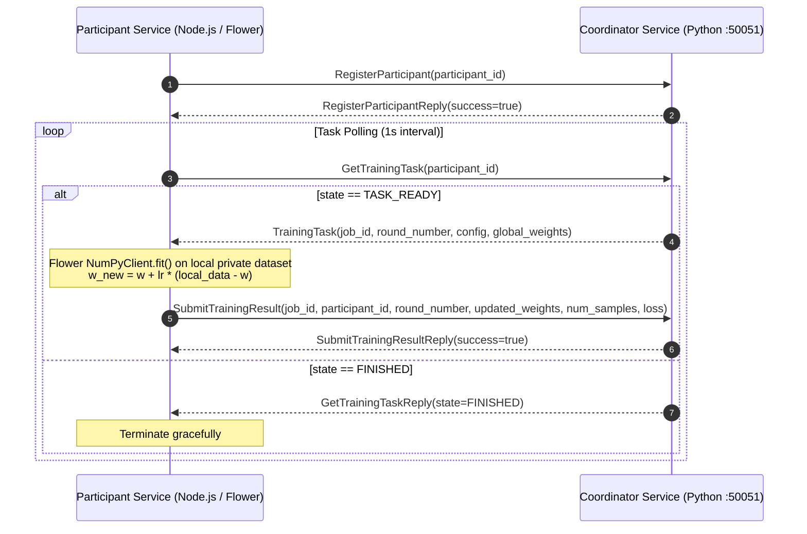

# Participant Service (Language B: Node.js & Flower AI)

**Project Role**: Student 3 - Participant Service  
**Technologies**: Node.js (`@grpc/grpc-js`, `@grpc/proto-loader`), Python (`flwr`, `numpy`), gRPC Protocol Buffers.  
**Federated Learning Framework**: **Flower AI (`flwr.client.NumPyClient`)**

---

## 1. Architecture & Workflow

This module implements the **Participant Service** for the distributed Federated Learning platform, fulfilling the multi-language requirement across independent operating system processes:
- **Coordinator Service**: Python (`../coordinator/server.py`)
- **Participant Service (Node.js)**: `participant.js` + `flower_bridge.js` + `model.js`
- **Participant Service (Python Flower Reference)**: `participant.py` + `flower_client.py`



---

## 2. Directory Structure

| File | Description |
|---|---|
| [`participant.js`](file:///d:/M2%20DISS/CLoud%20service/Federated_Learning_Project/participants/participant.js) | Main Node.js Participant Service (gRPC client, registration, task polling loop, result submission). |
| [`flower_bridge.js`](file:///d:/M2%20DISS/CLoud%20service/Federated_Learning_Project/participants/flower_bridge.js) | Asynchronous bridge from Node.js to the Python Flower `NumPyClient`. |
| [`flower_client.py`](file:///d:/M2%20DISS/CLoud%20service/Federated_Learning_Project/participants/flower_client.py) | Standard `flwr.client.NumPyClient` implementation holding the private local dataset and executing `fit()` / `evaluate()`. |
| [`model.js`](file:///d:/M2%20DISS/CLoud%20service/Federated_Learning_Project/participants/model.js) | Pure JavaScript fallback local model trainer (`LocalModelTrainer`). |
| [`participant.py`](file:///d:/M2%20DISS/CLoud%20service/Federated_Learning_Project/participants/participant.py) | Standalone Python Flower Participant client. |
| [`test_integration.js`](file:///d:/M2%20DISS/CLoud%20service/Federated_Learning_Project/participants/test_integration.js) | Automated end-to-end multi-process integration test. |
| [`data_A.csv`](file:///d:/M2%20DISS/CLoud%20service/Federated_Learning_Project/participants/data_A.csv), [`data_B.json`](file:///d:/M2%20DISS/CLoud%20service/Federated_Learning_Project/participants/data_B.json) | Sample custom local dataset files. |

---

## 3. Setup & Running Instructions

### Prerequisites
- Node.js (v18+)
- Python (v3.10+) with `flwr`, `grpcio`, and `numpy` installed in `../.venv`

```powershell
# Install Node.js dependencies
npm install --prefix participants
```

---

### Option 1: Automated End-to-End Integration Test
Runs the Coordinator, a Node.js Flower Participant, a Python Flower Participant, and a 2-round job in a single command:

```powershell
node participants/test_integration.js
```

---

### Option 2: Running Independent Processes (4 Terminals)

#### Terminal 1: Start Coordinator Service
```powershell
$env:PYTHONPATH="coordinator"
.\.venv\Scripts\python coordinator/server.py
```

#### Terminal 2: Start Participant 1 (Node.js + Flower AI)
Pass a custom vector directly via CLI or provide a path to a `.csv`, `.txt`, or `.json` file:
```powershell
# Using direct comma-separated numbers:
node participants/participant.js flower_node_1 10,10,10 localhost:50051

# Or using a custom dataset file:
node participants/participant.js flower_node_1 participants/data_A.csv localhost:50051
```

#### Terminal 3: Start Participant 2 (Python + Flower AI)
```powershell
$env:PYTHONPATH="coordinator;participants"

# Using direct comma-separated numbers:
.\.venv\Scripts\python participants/participant.py flower_py_2 30,30,30 localhost:50051

# Or using a custom dataset file:
.\.venv\Scripts\python participants/participant.py flower_py_2 participants/data_B.json localhost:50051
```

#### Terminal 4: Trigger Training Job
```powershell
$env:PYTHONPATH="coordinator"
.\.venv\Scripts\python coordinator/fake_client.py
```

---

## 4. Verification Output

With Participant 1 holding `[10, 10, 10]`, Participant 2 holding `[30, 30, 30]`, and `learning_rate = 0.5`:
- **Round 1**: Initial weights `[]` -> P1 updates to `[5, 5, 5]`, P2 updates to `[15, 15, 15]` -> Coordinator FedAvg = **`[10.0, 10.0, 10.0]`**
- **Round 2**: Global weights `[10, 10, 10]` -> P1 updates to `[10, 10, 10]`, P2 updates to `[20, 20, 20]` -> Coordinator FedAvg = **`[15.0, 15.0, 15.0]`**
- **Final Status**: `COMPLETED`
